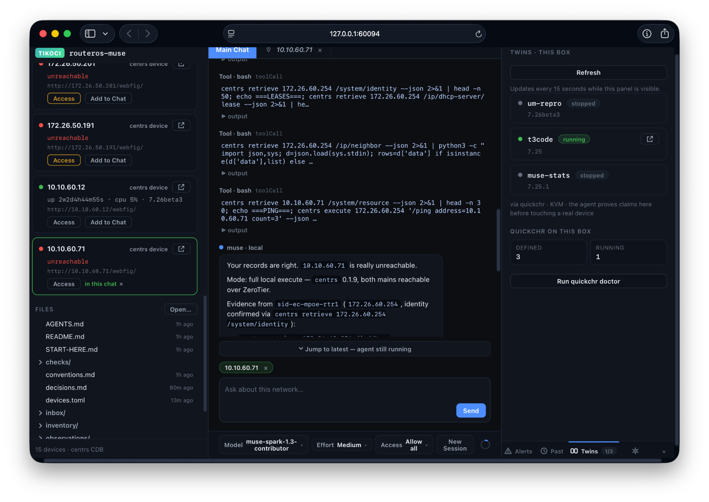
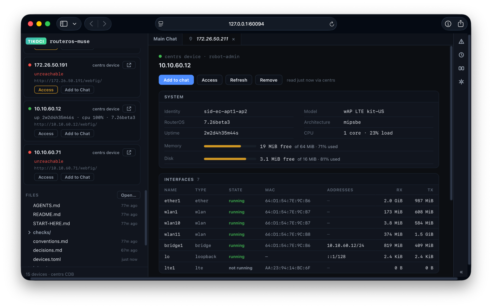

# routeros-muse

A RouterOS network workspace plus web UI that puts an agent beside
your network. You keep your network's docs, devices, and history in
one workspace folder; routeros-muse checks the machine, grounds the
agent on your real routers, and gives you a browser UI to chat with
it, watch it work, and view what it renders.

Built on the tikoci trilogy: [quickchr](https://github.com/tikoci/quickchr)
(disposable CHR twins), [centrs](https://github.com/tikoci/centrs)
(device access plus credentials), [rosetta](https://github.com/tikoci/rosetta)
(RouterOS knowledge). Started as a hackathon demo; now growing into a
real owner tool.

Status: **preview**. Expect rough edges; nothing here is finished.



*Chat with a device attached. The agent runs `centrs` reads against
the real network, shows each tool call, and reports its evidence. On
the right are the quickchr twins where it tests changes before
touching a real router.*



*A device tab. centrs reads it live: system resources and every
interface, with Add to chat, Access, Refresh, and Remove.*

## Quick start

Prereqs: [Bun](https://bun.sh) (per Bun's own install instructions),
plus the Muse agent from <https://dev.meta.ai> (`muse login` once to
sign in; `routeros-muse code` checks and offers the installer). Then:

```sh
bunx @tikoci/routeros-muse@next start   # web UI on 127.0.0.1 by default; opens your browser
```

From a checkout, `bun install` once, then `bun run start` does the
same. Creating a workspace asks for a CDB password — the device
registry (`device.cdb` beside the workspace) is created encrypted,
and the browser lands on the lock screen where you retype it. On a
terminal `start` walks you through template + password. For scripted
creation, pipe the password to `routeros-muse init <dir>
--password-stdin`, then run `routeros-muse start <dir>`. The web
picker's Create button asks in the form. `--open-cdb` creates without
encryption (dev escape, never the default). `make gate` runs the
full check (lint + tests + browser smoke).

Other commands: `init` scaffolds a workspace where you are, `code`
checks the machine then drops you in a `muse` shell in the
workspace, and `doctor` runs the same checks print-only.

## The workspace idea

A workspace is one folder that holds everything about a network:
`workspace.toml` (what this network is), `device.cdb` (its devices:
the centrs registry, mirrored read-only into `devices.toml` so plain
text tools see hosts and ports), `router.toml` (per-device intent),
`operations/` and `inbox/` (pending work and handoffs), plus
observations, reports, and history. The agent reads the workspace;
the workspace records what the agent did.

`templates/network/` is the full starter template: conventions,
skills, checks, and layout. New workspaces land in `~/Networks`, one
predictable path on every OS, and serving a workspace registers it
for the no-workspace picker. The web UI's whole-app lock is your CDB
password (see `docs/design/t39-auth-design.md`).

## How it uses the three tools

`package.json` pins `@tikoci/quickchr`, `@tikoci/centrs`, and
`@tikoci/rosetta`, all three on the `next` tag during preview (this
checkout's lockfile resolves centrs to `0.1.9`; Status shows the
installed versions). The bootstrap and
the server front the package's own `node_modules/.bin` on PATH for
every spawn — server subprocesses and agent children alike — so all
sides resolve identical builds:

- **quickchr** — twin capability probe (`quickchr doctor`) and
  disposable CHR routers for grounding claims, configs, and scripts.
- **centrs** — LAN discovery (MNDP), device reads and live stats,
  and the CDB credential store (`device.cdb` beside the workspace).
- **rosetta** — RouterOS device database and knowledge lookups for
  the agent, resolved from the same bundle.

## CLI

```sh
routeros-muse [command] [dir] [options]   # bare = start
routeros-muse start [dir] [--port N] [--host H] [--no-open] [--yolo]
routeros-muse init [dir] [--template minimal|network] [--password-stdin] [--open-cdb]
routeros-muse code [dir] [muse args...] [--yes] [--router H[:port]] [--print-only]
routeros-muse doctor [dir]
```

New workspaces are created encrypted: `init` and `start` option 1
prompt for the template (`--template` skips) and a CDB password
(hidden, typed twice) on a TTY, or take it from `--password-stdin`
off a TTY. `--open-cdb` is the explicit escape to an open registry.

`start` (alias: `serve`; bare means `start`): web UI over
the workspace — devices left, chat center, render/status right —
opened in your browser; `--no-open` prints the URL instead.
Defaults: host `127.0.0.1` (`--host` overrides the bind; only do that on
a trusted network), ephemeral port, provider `meta`. When
the directory (default: here) is not a workspace, a terminal offers
init-here / registered-workspace pick / browser picker; off a
terminal the default (here) serves with no workspace attached, while
a named directory that is not a workspace stops with the `init` line. `--yolo` starts the
agent session at its most permissive approval mode (`Allow all`).
The agent worker spawns trusted by default, so the workspace's
AGENTS.md and `.agents/skills/` load (Settings shows the state).
GUI sessions also load the packaged RouterOS skills by default,
including without a workspace or with workspace trust off. In Settings,
**Automatically load RouterOS skills** changes this for every GUI
session on the machine. The change applies to the next new or resumed
chat; it never interrupts a running turn. Independently installed or
workspace skills can still load. The skill version is pinned with the
package: startup works from local files, without contacting GitHub.
`--tui` aliases `code`. Developer flags: `--no-workspace`,
`--provider NAME`, `--allow-open-cdb` (an open CDB implies no auth),
`--no-trust-workspace` (spawn the agent untrusted: the workspace's
AGENTS.md and skills don't load).

Settings → **Disable sandbox** enables direct networking while retaining
the selected approval mode, including **Ask first**. It removes filesystem
and network isolation for web UI agents on this machine; approved commands
can access paths outside the workspace and any reachable address. Host
allow rules do not restrict those connections. Default: off. After changing
it, finish the current turn, stop `routeros-muse` and start it again with
the same workspace. Settings shows when a restart is pending. A page reload
or New Session does not apply it; reopen the previous chat from Past chats.

`init`: scaffolds a workspace in the directory (default: here) from
`minimal` (runnable minimum) or `network` (full starter), never
overwriting, with an encrypted `device.cdb`, and registers it.
`init` then exits, printing the `start` command; `start` opens the
browser on the lock screen, where you retype the password you set. The web picker's Create button scaffolds
into `~/Networks` instead, then navigates there itself.

`code`: checks prereqs, the trilogy, and the agent; opens and
validates the workspace; reconciles `[pins]`; probes twins and LAN
into a capability mode (`full` / `twin-only` / `real-box-only` /
`design-only`); lists handoffs; then execs `muse` in the workspace
with the package tool bundle on PATH. `--yes` is the one-yes for
echoed user-level installs; `--print-only` prints the launch line
instead of running it; every other arg passes through to `muse`
verbatim and in order (`-c`, `--yolo`, resume flags), with `--`
forcing the rest through. The workspace directory, if you name it,
goes first, before any `muse` arg. Nothing installs without asking.

`doctor`: the same checks print-only. Never installs, never execs
muse. Exit 1 when a required item is missing.

Fleet reads live in `centrs` (`devices list`, `retrieve`), not here;
agents use centrs/quickchr/rosetta directly.

## Docs

- `SECURITY.md` — security facts and known gaps.
- `docs/internals.md` — how the pieces fit (bootstrap steps, server
  routes, render services, unlock, registry, smoke).
- `docs/design/` — design notes carried from the staging archive.
- `docs/concepts/` — UI concept mockups (design references, not product).
- `records/` — the build tracker (needs/tasks/decisions/concepts).
- `templates/network/` — the starter workspace template.
- `tools/` — skill gate, UI smoke, router capture plus checker.
